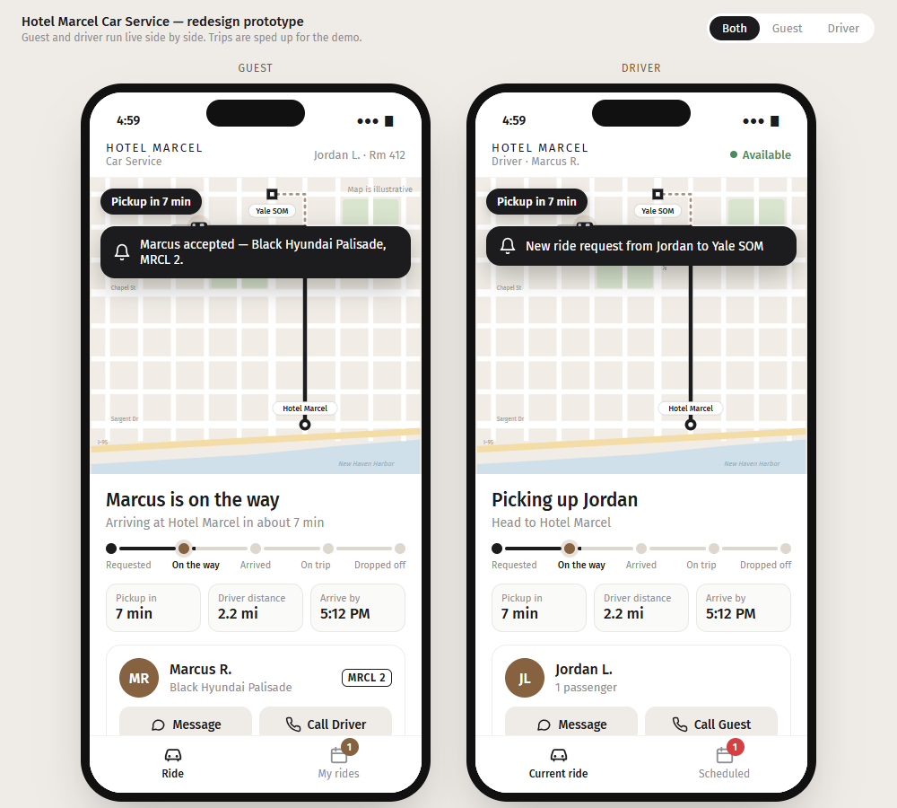
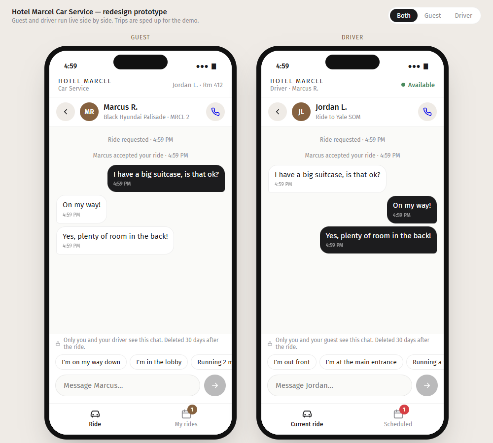
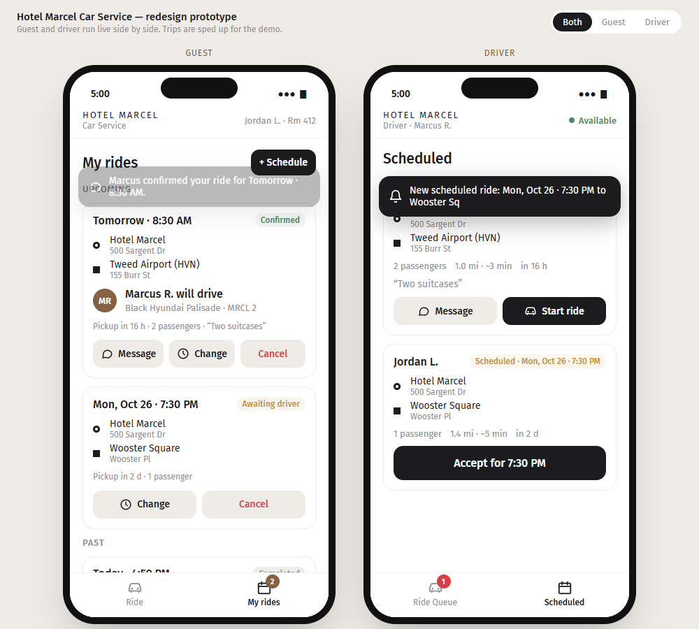
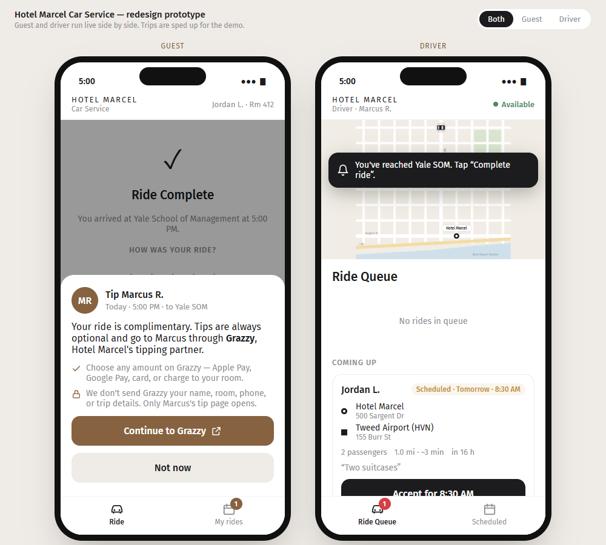

# Side Project — Hotel Marcel Car Service Redesign

*Uber-style redesign prototype · MGT 409 (Fall 2026) by N Stein · part of the [MGT 409 portfolio](https://github.com/nsteinyale/mgt409-portfolio)*

**▶ Try it live: https://nsteinyale.github.io/hotel-marcel-ride-redesign/** (works on a phone or computer, nothing to install)

A clickable prototype of four upgrades to Hotel Marcel's complimentary car service app ([ride.hotelmarcel.com](https://ride.hotelmarcel.com/ride)):

1. **Two-way messaging** between guest and driver, with quick replies, a typing indicator and unread badges.
2. **Live trip progress**: the route greys out behind the car, a five-stage tracker fills in, and the countdown and arrival time update live.
3. **Booking rides in advance**: Ride now / Schedule, the next 7 days in 15-minute slots, and a **My rides** list with Change and Cancel. Drivers get a **Scheduled** tab.
4. **Optional tipping through Grazzy**: rides stay free, and the tip button opens the driver's own Grazzy page.

The guest and driver phones run side by side and share live state. Trips are sped up for the demo. The map is a simplified drawing of New Haven, not real GPS.

A short course-style write-up is in **[report.html](report.html)** (download and double-click to read it). The proposal for the hotel is **[Hotel-Marcel-Car-Service-Proposal-1.docx](Hotel-Marcel-Car-Service-Proposal-1.docx)**. It covers what exists today, the prototype, Grazzy, what's missing, privacy controls, how to pitch it, and a draft intro email.

| Trip progress | Chat | Scheduled rides | Grazzy tip |
|---|---|---|---|
|  |  |  |  |

## Try it

Open `index.html` in Chrome, Edge or Safari. Nothing needs to be installed or run first.

- **Computer:** both phones show side by side. Use the **Both / Guest / Driver** switch in the top-right corner.
- **Phone:** one screen with a **Guest / Driver** switch at the top.

### Manual test checklist (about 3 minutes)

| # | Do this | You should see |
|---|---|---|
| 1 | Guest: pick a destination → **Request Ride** | Guest: "Finding your driver". Driver: a new request card and an alert |
| 2 | Driver: **Accept ride** | The car moves; the progress bar and "Pickup in N min" count down |
| 3 | Guest: **Message** → send "I'm in the lobby" | Driver: an alert plus a red **1** on Message |
| 4 | Driver: open Message → start typing | Guest: "Marcus is typing…" |
| 5 | Wait (~25 s) | Guest: "Your driver has arrived" |
| 6 | Driver: **Guest Picked Up**, wait, then **Complete ride** | The second leg fills in; then Ride Complete with stars |
| 7 | Guest: **Tip Marcus for great service** | A sheet saying the tip is optional; **Continue to Grazzy** opens grazzy.com |
| 8 | Guest: **Schedule** → pick a day and time → **Schedule Ride** | **My rides** shows "Awaiting driver"; the driver's **Scheduled** tab shows it |
| 9 | Driver: **Accept for …** | Guest card turns **Confirmed** and offers Message |
| 10 | Guest: **Change** the time | Driver gets an alert with the new time |
| 11 | Check driver screens | The guest's room number never appears |

Refreshing the page resets everything. There's always one sample airport ride booked for tomorrow.

### Automated test

The test needs Node 22 or newer and Chrome or Edge. No npm install is needed.

```bash
node tests/e2e.mjs
```

It runs 18 checks in a hidden browser, including:
- a full ride, from request through drop-off and rating
- chat in both directions, unread badges and the typing indicator
- message text is never run as HTML or script
- trip progress moves
- scheduling, confirming, changing and cancelling a booked ride
- the Grazzy link carries no personal data
- drivers never see room numbers
- the phone layout
- no JavaScript errors

To test the live site instead of the local file, add its URL: `node tests/e2e.mjs https://nsteinyale.github.io/hotel-marcel-ride-redesign/`.

It takes about a minute, mostly waiting for the simulated car. Add `--shots` to save screenshots to `tests/output/`. If your browser isn't found automatically, set the `BROWSER` environment variable to its path.

## Privacy built into the prototype

- **Drivers see less:** drivers see first name and last initial only, never the room number.
- **Chat notice:** each chat says only the guest and driver see it and that it's deleted 30 days after the ride.
- **Plain-text messages:** chat text is always plain text, so HTML and scripts in a message can't run.
- **Tipping:** the Grazzy tip link carries no name, room, phone or trip details, and drivers aren't told who tipped.

The proposal (Section 5) covers what a production version would also need: masked calling, location shared only during a ride, one-time text-code sign-in, individual driver logins, retention limits, and guardrails if AI features are added later.

## What's real and what's demo

| Demo stand-in | Production version |
|---|---|
| Drawn map, simulated car | Mapbox map and driver phone GPS (the live app already uses Mapbox) |
| State lives in the page, reset on refresh | Server storage plus the app's existing live updates (WebSockets) |
| `grazzy.com` placeholder tip link | Each driver's Grazzy page, pasted into the existing per-driver "Tip link" setting |
| Sample names (Marcus R., Jordan L.), car and phone numbers | Real drivers and guests |
| Booking hours 7 AM – 11 PM, 30-minute lead time | The hotel's real operating hours and rules |

## Files

```
index.html                                 the whole prototype (HTML + CSS + JS, no build step)
tests/e2e.mjs                              automated end-to-end test
report.html                                short final-project-style write-up (open by double-clicking)
Hotel-Marcel-Car-Service-Proposal-1.docx   proposal for the hotel
preview-*.png                              screenshots used here and in the proposal
```

---

An independent student concept from Yale SOM MGT 409 (AI Foundations for Managers), Fall 2026. It isn't affiliated with or endorsed by Hotel Marcel or Grazzy. It's built only from the public pages of ride.hotelmarcel.com and uses no guest data.
